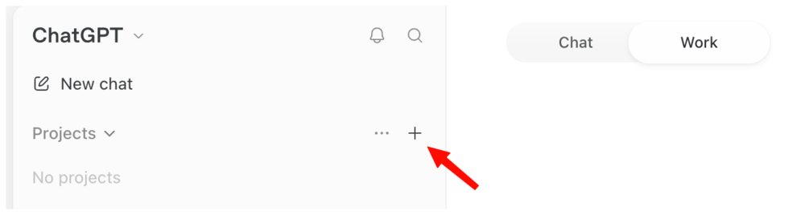
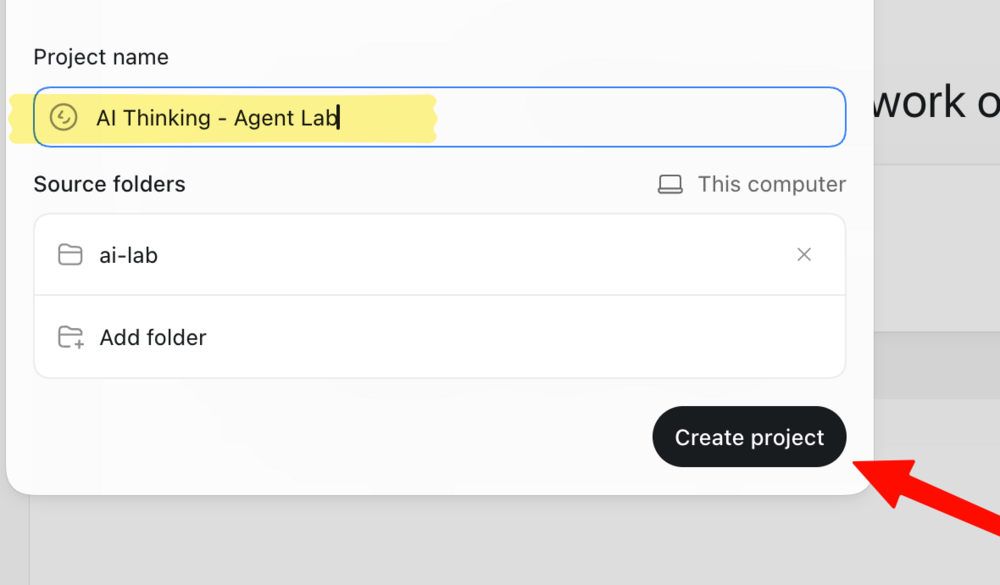
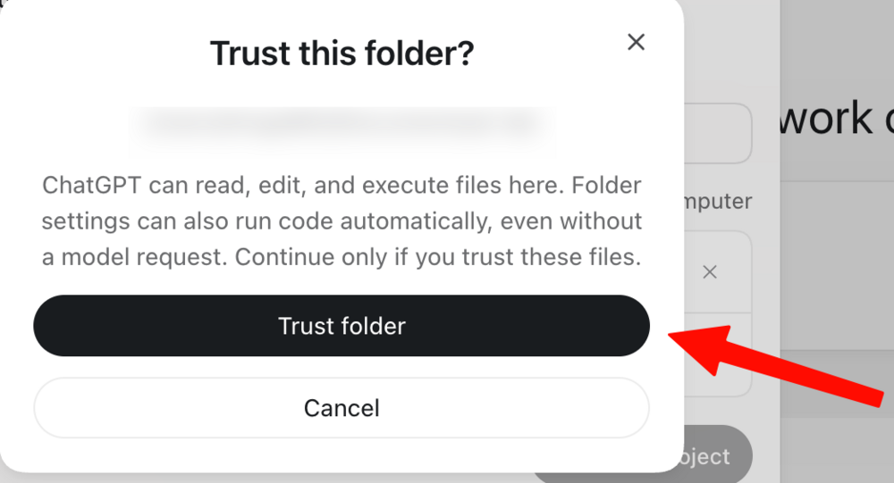
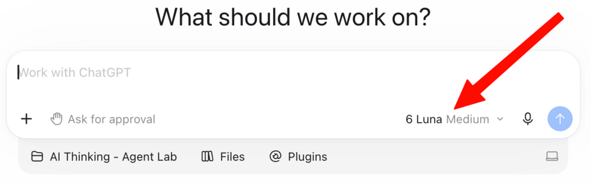

::: {.hero}
::: {.kicker}
Lecture page
:::

# Why and How to Think with AI: <strong>prompts, starter folder, and slides</strong>

::: {.lead}
Everything you need for the two exercises in the lecture, plus the slides and the sources behind them. Keep this page open on your laptop while we work.
:::

::: {.byline}
Tim Gåsste · Department of Peace and Conflict Research, Uppsala University
:::

::: {.jump}
[Get ready](#get-ready){.primary} [Exercise 1](#exercise-1) [Exercise 2](#exercise-2) [Slides](#slides) [Sources](#sources)
:::

[**Download the ai-lab starter folder** (.zip, with the slides inside)](downloads/ai-lab.zip){.download-bar}
:::

::: {.notice}
**Important:** this is an inspirational lecture on thinking with AI. It is **not a general permission to use AI in your studies.** Always follow the AI rules for your course module, and ask your course convener when in doubt. The views and workflows here are my own. They build on the commentators listed under [Sources](#sources).
:::

## Get ready at the start {#get-ready}

Do this at the start of the lecture. The download runs in the background while we talk, and you will need the app in Exercise 1.

::: {.steps}
1. **Download the ChatGPT desktop app** for Mac, Windows, or Linux from OpenAI's [quickstart page](https://learn.chatgpt.com/docs/quickstart).
2. **Open it and create a free account**, or log in to the one you have.
3. **[Download the ready-made ai-lab folder](downloads/ai-lab.zip)** and unzip it into your **Documents** folder.
:::

**A free account is enough,** today and after the lecture. See [Keep going after today](#keep-going).

Stuck, or just curious? Ask at any point. There are no stupid questions about AI.

## Basic setup: folder, agent, instructions {#basics}

::: {.basics}
::: {.basic}
#### [1]{} A folder on your computer

An ordinary folder in Finder (Mac) or File Explorer (Windows), not something inside the AI app. You choose which folder the agent may open.
:::

::: {.basic}
#### [2]{} The app deploys an agent

Create a project from that folder, and the app does more than chat. Its agent reads the files, works on your task step by step, and saves new files there. You check and decide. In ChatGPT this happens in **Work**, and other apps have their own name for it.
:::

::: {.basic}
#### [3]{} Instructions in a text file

**Markdown** (`.md`) is plain text with a few marks: `#` for a heading, `-` for a bullet. Models read it most reliably.
:::
:::

A Markdown instructions file can be this short:

```markdown
# About me
- MSc student in peace and conflict research
- Quiz me before you explain
- Ask before you overwrite a file
```

::: {.word-tip}
**Prefer Word to Markdown, or Excel to `.csv`?** That is completely fine. What matters is that the model gets your information as text and numbers, in a form that fits you and your workflow.
:::

## Exercise 1: Set up your local agent {#exercise-1}

[10 minutes]{.timer} Build the "harness" you will use for the rest of the lecture: a folder, an agent that can work in it, and a standing instructions file.

### Open your folder in ChatGPT

In ChatGPT, Work reaches a folder on your computer through a **project**. Four clicks:

::: {.setup-grid}
::: {.setup-card}
{fig-alt="ChatGPT desktop app: the Work tab at the top and the plus button next to Projects."}

**1.** Choose **Work** at the top of the window, then the **+** next to Projects.
:::

::: {.setup-card}
{fig-alt="Create project dialog with a project name and the ai-lab folder added."}

**2.** Give the project a name, click **Add**, pick **Documents → ai-lab**, and click **Create project**.
:::

::: {.setup-card}
{fig-alt="Trust this folder dialog with the Trust folder button."}

**3.** Click **Trust folder**. The agent can now read and save files in `ai-lab`, and nowhere else.
:::

::: {.setup-card}
{fig-alt="The Work message box inside the project, with Ask for approval and the default model."}

**4.** Ready. Keep **Ask for approval** on and the default model (6 Luna Medium). Paste your first task.
:::
:::

### Then do the exercise

::: {.steps}
1. **Find the `ai-lab` folder in your Documents folder.** No download? [Get it here](downloads/ai-lab.zip), or create a normal folder called `ai-lab` there yourself, with two subfolders: `sources` and `outputs`.
2. **In the ChatGPT desktop app, choose Work and create a project from `ai-lab`**, as shown above. Another app whose agent can work in a folder works too.
3. **Give it the task below**, and answer its five questions. Short answers are fine.
4. **Open `INSTRUCTIONS.md` (or `.docx`).** Check it, and change one thing yourself.
:::

Your first task:

```{.markdown .prompt}
Interview me with five short questions, one at a time, about my studies, my goals, and how I want you to help me learn. Then save my answers and these rules as INSTRUCTIONS.md in this folder: use only files in this folder, never invent sources, and ask before you overwrite a file.
```

::: {.word-tip}
**Prefer Word?** Ask for `INSTRUCTIONS.docx` instead of `INSTRUCTIONS.md`. It takes about a minute longer. Markdown is plain text, which models read most reliably, but a Word file works too.
:::

**Finished early?** Ask the agent to change your instructions, for example "Update INSTRUCTIONS.md so that you always answer in Swedish." Watch it ask for your permission first. Those are your instructions at work.

**Struggling to get the agent working on your computer?** Pair up with a neighbor, or paste the task into a normal chat and save the answer as `INSTRUCTIONS.md` (or `.docx`) yourself.

## Exercise 2: Put your agent to work {#exercise-2}

[10 minutes]{.timer} Use this lecture's PDF in `sources/` (already there if you downloaded the folder), or add your own notes. Word files, PDFs, and spreadsheets are fine. Then **pick one option. One is enough.** Replace the [brackets] with your own concept or argument.

Every prompt starts with **"Read my INSTRUCTIONS file,"** because the agent does not read it on its own, and ends by saying **where to save**, because otherwise it only answers in the chat.

::: {.option}
### [A]{.letter} Study partner

Practice retrieval on something you need to know. Saves flashcards in `outputs/` (ask for an Excel file if you prefer).

```{.markdown .prompt}
Read my INSTRUCTIONS file. Quiz me on [concept] using only sources/, three questions, one at a time. Then save flashcards for my weak spots in outputs/.
```
:::

::: {.option}
### [B]{.letter} Sparring partner

Stress-test an argument you are working on. Saves the critique in `outputs/` (ask for Word if you prefer).

```{.markdown .prompt}
Read my INSTRUCTIONS file. Steelman the strongest objection to [my argument] and list my unsupported leaps. Do not rewrite my text. Save it in outputs/.
```
:::

::: {.option}
### [C]{.letter} Explain and listen

Get a hard idea explained the way you learn best. Saves the script in `outputs/`. Click the speaker icon under the answer to hear it read aloud.

```{.markdown .prompt}
Read my INSTRUCTIONS file. Explain [hard concept] from sources/ at my level, as a three-minute script I can listen to. Save it in outputs/.
```
:::

**Afterwards:** tell your neighbor one thing the agent got wrong, or one thing you now understand better.

## Keep going after today {#keep-going}

The free plan goes a long way. On ChatGPT Free, Work (and the related agents, such as Codex) has a **monthly usage limit**, and ordinary chats do not count toward it. When I tested every step of both exercises on a free account, it used **about 6%** of that monthly allowance.

- **Keep the default model** (6 Luna Medium in October 2026). It was fast, accurate, and stayed within the sources.
- **See what you have left** under Settings → Usage & billing.
- **Make it a habit.** Keep the `ai-lab` project. Before a seminar, ask your study partner to quiz you on the readings. Before you hand in a draft, ask your sparring partner for the strongest objection.

Limits and model names change. These figures are from October 2026.

## Which tool? {#tools}

- **Start here:** choose one general assistant (ChatGPT, Claude, Gemini, Grok, Microsoft Copilot, or Perplexity), use it, and learn it well. That is where you get the most value for the least effort.
- **Answers only from your own documents:** NotebookLM, now called Gemini Notebook, answers from the documents you give it and cites the passage behind each answer. Use it when nothing else should creep in: a contract, a court ruling, a policy, or your course readings.
- **Literature:** Elicit, Semantic Scholar, Scite, and Litmaps help you discover and assess research. Zotero manages your references.
- **Agents in a folder:** ChatGPT (Work and Codex), Claude, GitHub Copilot, and Cursor can work inside a project folder.

## Question engineering {#question-engineering}

You do not need intricate, extensive prompt strategies. Strong models plan the steps better than our scripts do, and over-specifying imposes our own, often flawed, framing of the problem. What still matters is that you **frame a great question**: a clear goal, real context, and your standard of quality. Call it question engineering.

### Anatomy of a good question

This is the long version, written out in full for a research task. Most questions need only a few of these elements. The numbers mark them: task, purpose, context, material, constraints, format, evaluation, and interaction.

```{.markdown .prompt}
(1) Help me assess whether political exclusion increases the risk of organized political violence. (2) I want to sharpen a research question before drafting a theory section, not receive a finished argument. (3) I am working in peace and conflict research and preparing a graduate seminar memo, so focus on mechanisms, scope conditions, alternative explanations, and observable implications. (4) Use only the notes and source excerpts I paste below. (5) Separate author claims from your inferences, mark unsupported claims as "needs source", and do not invent citations. (6) Return a four-step causal pathway, two counterarguments, three questions I must answer, and one next prompt. (7) A strong answer is specific, source-bounded, mechanism-focused, and honest about uncertainty. (8) Ask one clarifying question if needed, then wait for my response before revising the research question.
```

## More prompts from the lecture {#more-prompts}

### Your study partner (Socratic tutor)

A Socratic tutor teaches by asking rather than telling: one question at a time, hints when you are stuck, and an explanation only after you have tried. The set-up matters. In a large field experiment, students with a plain chatbot did better while practicing but worse on a later exam without AI, while a tutor-style version that gave hints instead of answers avoided that drop ([Bastani et al. 2025](https://doi.org/10.1073/pnas.2422633122)).

```{.markdown .prompt}
Read my INSTRUCTIONS file. Using only sources/, quiz me on the hardest concept, one question at a time, and wait for my answer before you explain. Then save flashcards for my weak spots in outputs/.
```

### Your sparring partner

The AI critiques, and you revise and write. Put your outline in a `working/` folder first (a Word file is fine).

```{.markdown .prompt}
Read my INSTRUCTIONS file and working/outline.md. Do not rewrite my text. Steelman the strongest objection, list my unsupported leaps, and save both in outputs/. Then ask me three hard questions.
```

### Working with data

Put your output or script in `sources/` first (a text file, a Word file, or a screenshot). Without it, the agent says it cannot see any output rather than inventing numbers. The model explains, and you decide what the numbers mean.

```{.markdown .prompt}
Read my INSTRUCTIONS file. Explain the regression output in sources/ line by line, at my level. Tell me what I can and cannot conclude from it, and do not invent any numbers.
```

```{.markdown .prompt}
Read my INSTRUCTIONS file. Comment my R script in sources/ line by line so I understand each step. Suggest one improvement, but do not change what the script does without asking me.
```

## Use it responsibly {#responsibly}

- **Confidentiality and copyright.** Do not upload confidential data or copyrighted material without approval or clearance. Your own notes and this lecture's slides are fine.
- **File access.** The agent can edit files. Give it one folder, not your whole computer, and ask it to check with you before overwriting anything.
- **Verification.** Tell it never to invent sources, and check every number, quote, and source yourself. You remain responsible for your work.
- **Know when to close the AI.** When learning has to stick, try it on your own first. Then use AI to check your answer and go deeper.
- **Make the knowledge yours.** If you cannot explain and defend it, it is not yours yet. Develop your own capacity to think and learn, and use AI to amplify it.

## Slides {#slides}

::: {.slides-card}
[**Open the slides** Interactive version in your browser](slides/index.html)

[**Download the PDF** Static, searchable version for reading and notes](downloads/why-and-how-to-think-with-ai.pdf)
:::

## Sources and further listening {#sources}

::: {.refs}
The views and workflows in this lecture are my own. Many of the ideas build on these commentators, and I recommend following them.

**Ethan Mollick** (2026). "[The Overhang](https://www.oneusefulthing.org/p/the-overhang)." *One Useful Thing*, 18 September.

**Ethan Mollick** (2026). "[The Dot and the Swarm](https://www.oneusefulthing.org/p/the-dot-and-the-swarm)." *One Useful Thing*, 1 October.

**Andrej Karpathy** coined "vibe coding" (February 2025) and proposed "agentic engineering" (February 2026) in posts on X.

**Sebastian Raschka** (2026). "[Components of a Coding Agent](https://magazine.sebastianraschka.com/p/components-of-a-coding-agent)." *Ahead of AI*, 4 April.

**Jensen Huang** (2025). Remarks at the Milken Institute Global Conference, 6 May. Reported by CNBC, 28 May.

**NPR** (2026). "Why AI companies are hiring philosophers to help develop their models." *All Things Considered*, 7 July.

**Bastani, H., et al.** (2025). "[Generative AI without guardrails can harm learning: Evidence from high school mathematics](https://doi.org/10.1073/pnas.2422633122)." *PNAS* 122(26).

**Jonas von Essen and Benjamin Verbeek.** *AI med Jonas & Benjamin* (podcast, in Swedish). Jonas von Essen on [YouTube](https://www.youtube.com/@BlueberryClubSparven).
:::

::: {.small}
Image credit in the slides: Jensen Huang, official White House photo by Daniel Torok (public domain). Questions or corrections: [tim.gasste@pcr.uu.se](mailto:tim.gasste@pcr.uu.se).
:::
